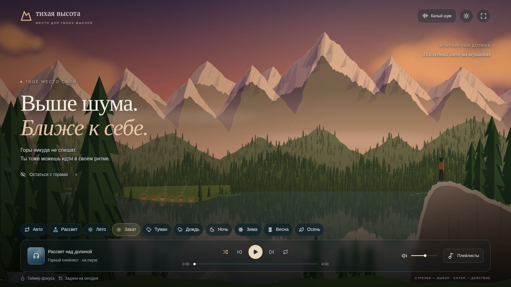
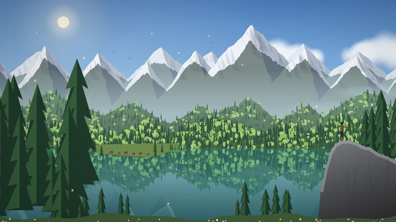
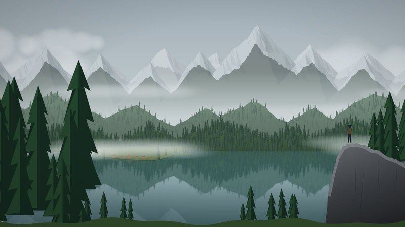
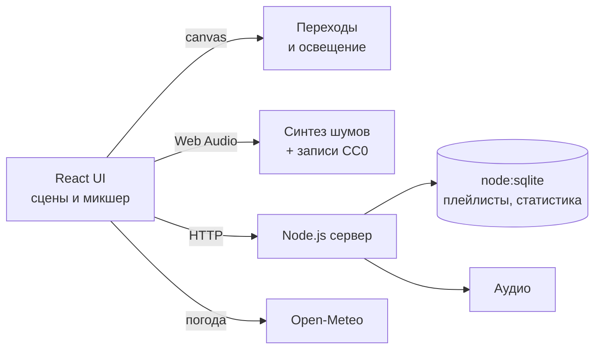

<div align="center">

# 🏔 Тихая высота · Vibe Island

**Место для твоих мыслей.** Живые горные пейзажи, музыка и звуки природы для фокуса и отдыха — в браузере компьютера или Smart TV.

[**🌐 Открыть демо**](https://denis-vr.github.io/Vibe_iseland/) · [Запуск](#-запуск) · [Как устроено](#-как-устроено) · [Подробная документация](docs/DETAILS.md)

       [](LICENSE)



</div>

## ✨ Что внутри

<table>
<tr>
<td width="50%" valign="top">

### 🌄 Живая долина
Одна долина в **9 сценах**: весна, лето, осень, зима, рассвет, туман, дождь, закат, звёздная ночь. Плавные переходы между сценами, медленно плывущие облака, ночью светятся окна домиков.

</td>
<td width="50%" valign="top">

### 🌦 Реальная погода
Выбери город или своё местоположение — сцена подстроится под настоящую погоду, сезон и время суток по данным **Open-Meteo**: снег, дождь, туман, рассвет и закат.

</td>
</tr>
<tr>
<td width="50%" valign="top">

### 🎧 Микшер звуков
**12 каналов**: белый, розовый и коричневый шум, дождь, ливень, ветер, водопад, ручей, птицы, костёр и другие. Шумы синтезируются в Web Audio, природные звуки — полевые записи CC0.

</td>
<td width="50%" valign="top">

### 🎵 Музыка и фокус
9 встроенных композиций (36 минут) с выровненной громкостью, плейлисты, повтор и перемешивание. Крупный таймер сессии виден даже в режиме без интерфейса.

</td>
</tr>
</table>

<table>
<tr>
<td></td>
<td></td>
</tr>
<tr>
<td></td>
<td></td>
</tr>
</table>

📺 **Работает на телевизоре**: управление стрелками, Enter и Back — запусти сервер на компьютере и открой сайт в браузере Smart TV в той же сети.

## 🚀 Запуск

Нужен **Node.js 24+**.

```sh
npm ci
npm run build
npm start          # http://localhost:4173
```

Для разработки — `npm run dev` (порт 5173). Для телевизора в домашней сети — `HOST=0.0.0.0 npm start` и открыть `http://IP-КОМПЬЮТЕРА:4173`.

## GitHub Pages

Workflow `.github/workflows/pages.yml` собирает сайт для адреса проекта `https://denis-vr.github.io/Vibe_iseland/` и публикует папку `dist-local` после push в `main`. В настройках репозитория выбери **Settings → Pages → Build and deployment → Source: GitHub Actions**.

На Pages доступны сцены, встроенная музыка, звуковой микшер, таймер и локальные плейлисты (сохраняются только в браузере). Серверные функции, включая загрузку своих треков и общую библиотеку, требуют серверной версии.

## 🧩 Как устроено



| Файл | Что делает |
|---|---|
| [`app/landscape.tsx`](app/landscape.tsx) | Переходы между сценами, облачные слои |
| [`app/noise-engine.ts`](app/noise-engine.ts) | Движок звука на Web Audio API |
| [`app/world.ts`](app/world.ts) | Порядок погоды, сезоны и освещение |
| [`server/index.mjs`](server/index.mjs) | Самостоятельный HTTP-сервер без фреймворков: SQLite, Range-запросы, защита Origin |

- **Без внешних зависимостей во время работы**: музыка лежит вместе с сайтом, пейзажи рисуются кодом, сервер — чистый `node:http`.
- **Приватность**: геопозиция запрашивается только по нажатию, на погодный сервис уходит центр ближайшего города, а не точные координаты.
- **Громкость**: все треки выровнены двухпроходным FFmpeg loudnorm до −21 LUFS.

## ✅ Проверки

```sh
npx tsc --noEmit
npm run lint
node --experimental-strip-types --test tests/world.test.ts tests/noise.test.ts tests/noise-engine.test.ts tests/local-server.test.mjs
```

Серверные тесты работают на временных SQLite-базах: пароль, запрет чужого Origin, конфликт ревизий, Range/HEAD, восстановление после перезапуска.

## 📄 Лицензия

Код распространяется по лицензии [MIT](LICENSE). Сторонние файлы сохраняют свои лицензии: [shadcn/ui](vendor/shadcn-tailwind-4.13.0.LICENSE.md), [плагин сборки](build/sites-vite-plugin.LICENSE), звуки — см. [SOURCES.md](public/audio/SOURCES.md).

## 📚 Дальше

- [Подробная документация](docs/DETAILS.md) — перенос на сервер, погода, таймер, статистика посещений
- [Развёртывание: nginx, systemd, HTTPS](deploy/README.md)
- [Источники звуков](public/audio/SOURCES.md)

---

<div align="center">

Сделал [Денис Рябчиков](https://github.com/Denis-VR) · если проект понравился — поставь ⭐

</div>
